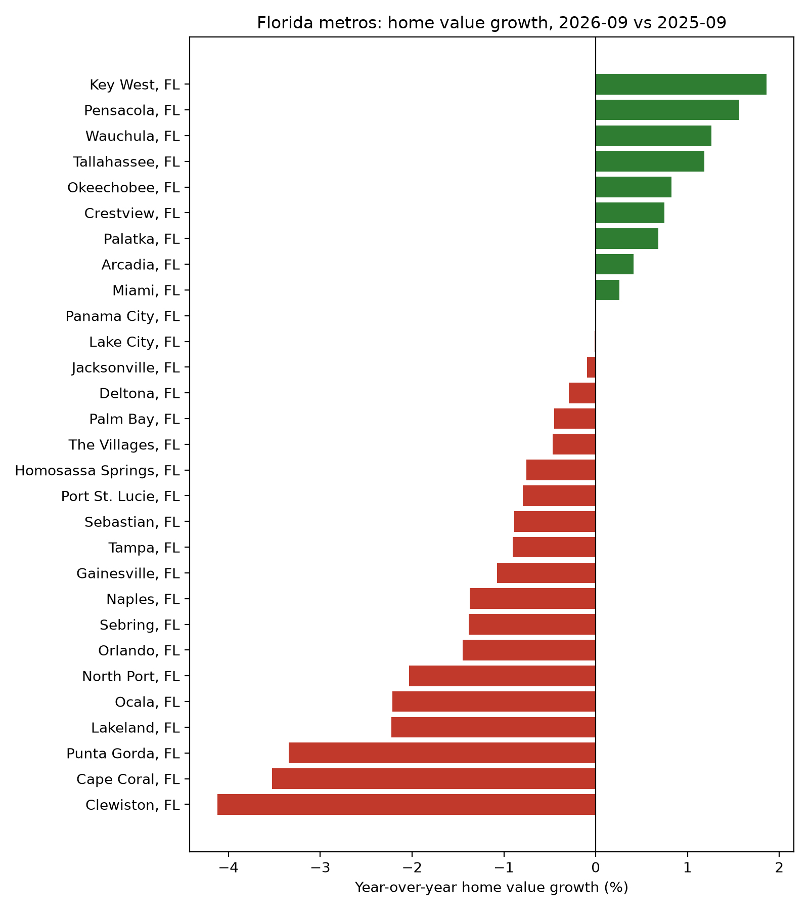

# Florida Housing Data Pipeline

Which Florida metros had the fastest year-over-year home value growth in Zillow's latest available month? This project reshapes Zillow metro data with pandas, averages weekly national mortgage rates by month, and loads both tables into SQLite. A SQL query ranks the metros and shows the national mortgage rate for that month. The script also saves a chart and a CSV.



## View the results without Python

1. Look at the chart above.
2. Open `florida_growth.csv` in this repo, click the download button, and open it in Excel.
3. Repository owners can refresh both files from the Actions tab: choose "Refresh housing chart", then "Run workflow".

## Run locally

Install Python 3.10 or newer and Git. Then run:

```
git clone https://github.com/memetheny/Florida-Housing-Data-Pipeline. Florida-Housing-Data-Pipeline
cd Florida-Housing-Data-Pipeline
python -m pip install -r requirements.txt
python pipeline.py
```

On macOS, use `python3` if that is the command your system recognizes. On Windows, use `py` instead of `python`.

If the download fails with a certificate error on macOS, open your Python folder in Applications and run `Install Certificates.command`, then try again.

## What the script produces

- A printed table of the five metros with the fastest growth
- `housing.db`, a local SQLite database with the cleaned data
- `florida_growth.csv` and `florida_growth.png`, covering every Florida metro in the data

Each run refreshes the two database tables. The query compares each metro with the same calendar month a year earlier. Metros missing either home value are excluded.

## Limits

- The national mortgage rate gives context and is the same for every metro.
- The analysis covers only the latest month in Zillow's data.
- Percent growth does not show market size, so small metros can rank high on small price changes.

## Sources

- [Zillow Research](https://www.zillow.com/research/data/) supplies the metro-level Zillow Home Value Index for all homes, smoothed and seasonally adjusted.
- [Freddie Mac via FRED](https://fred.stlouisfed.org/series/MORTGAGE30US) supplies the weekly U.S. 30-year fixed mortgage rate.

## License

The code is under the MIT License. Zillow and FRED set their own terms for their data.
